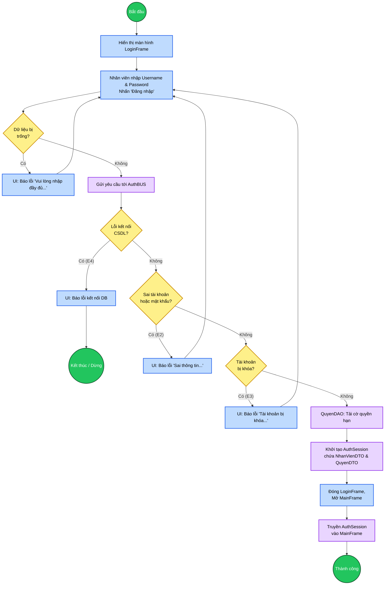

# Sơ đồ Hoạt động (Activity Diagram): UC-01 - Đăng nhập

**Dự án:** Phần mềm Quản lý Cửa hàng Giày (KYPM)
**Mục tiêu:** Mô tả luồng xử lý chi tiết của Use Case 01, bao gồm cả luồng chính (Happy Path) và các nhánh lỗi (Alternative Flows) để phục vụ việc viết Unit Test (đặc biệt là cho lớp `AuthBUS`).

