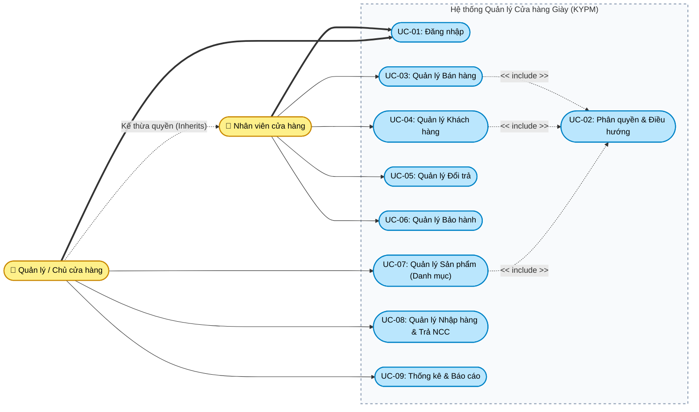

# Sơ đồ Use Case Tổng quát (General Use Case Diagram)
**Dự án:** Phần mềm Quản lý Cửa hàng Giày (KYPM)

Dưới đây là mã nguồn `Mermaid` biểu diễn Sơ đồ Use Case tổng quát của hệ thống. Bạn có thể xem nó trực quan trên các trình duyệt Markdown hỗ trợ Mermaid (như GitHub, GitLab, Notion).

